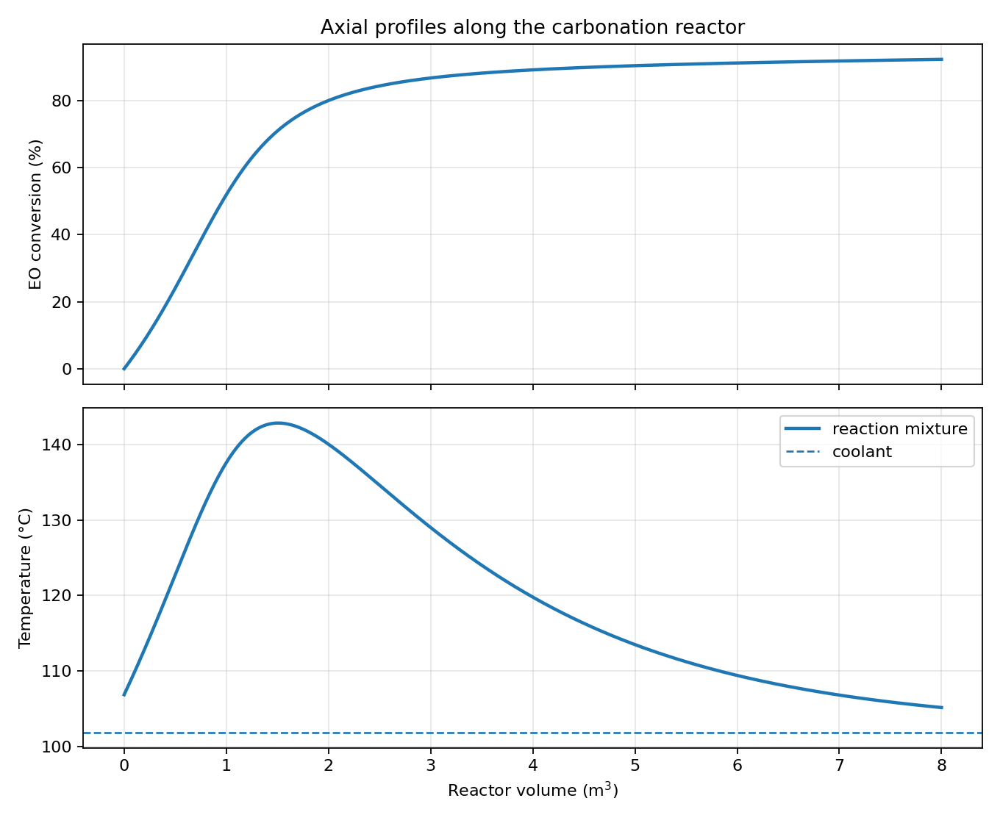
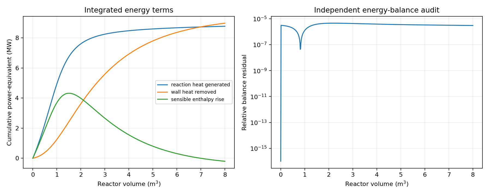
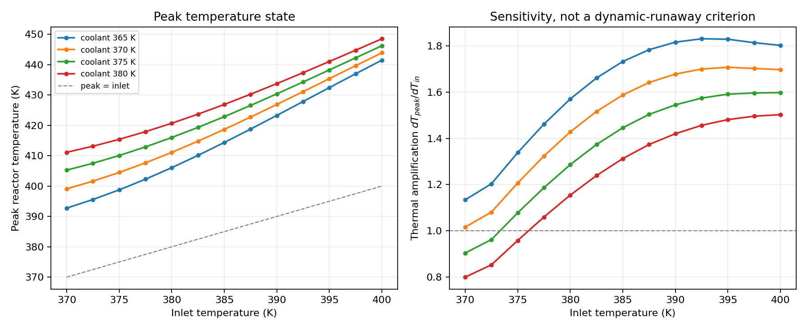
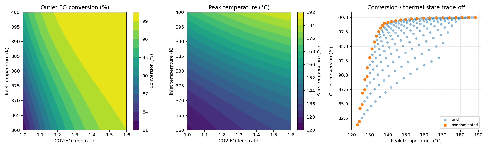
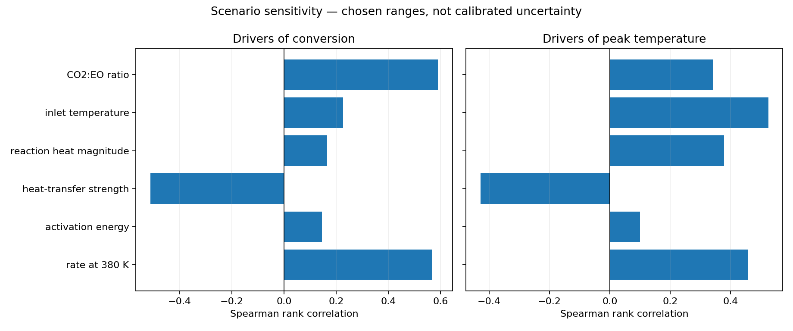

# Non-Isothermal Carbonation Reactor — Thermal Sensitivity & Operating Window

[](https://github.com/AhmadEblagh205/meg-carbonation-reactor/actions/workflows/ci.yml)


A clean, tested reconstruction of the **ethylene-oxide carbonation reactor** from my UCL mono-ethylene-glycol group design project. The full plant was a team exercise; the reactor modelling here was my individual section. The repository focuses on the part I can defend directly: coupled mole/energy balances, numerical validation, thermal sensitivity and operating trade-offs.

> **Scope boundary:** the kinetics and thermodynamic values are illustrative placeholders chosen to produce physically interpretable behaviour. This is **not** a validated industrial reactor model, plant prediction, or dynamic process-safety study.

## Why this project is interesting

A non-isothermal exothermic PFR has two linked questions:

1. how much conversion does extra temperature / reactant excess buy?;
2. what thermal consequence comes with that conversion?

The project now separates three concepts that are easy to blur together:

- **thermal state** — how hot the reactor gets;
- **thermal sensitivity** — how strongly the peak responds to a small operating change;
- **dynamic runaway/stability** — which this steady-state model does **not** claim to determine.

The strongest result is slightly counter-intuitive: **stronger cooling lowers the absolute peak temperature but can increase local thermal amplification with respect to feed temperature.** The coolant giving the hottest state is therefore not the coolant giving the largest local sensitivity.

## Model

The single reaction is

```text
EO + CO2 -> ethylene carbonate
```

with a second-order Arrhenius rate and a wall-cooled pseudo-homogeneous PFR. The numerical state is reaction extent plus temperature; using reaction extent makes 1:1 stoichiometry exact and lets the solver stop reaction cleanly when the limiting reactant is exhausted.

Core balances are documented and derived in [`docs/METHODOLOGY.md`](docs/METHODOLOGY.md).

Assumptions include constant volumetric flow, constant `rho*Cp`, constant heat of reaction, constant wall heat-transfer coefficient per reactor volume, constant coolant temperature and one irreversible reaction. No gas-liquid mass transfer, phase equilibrium, catalyst deactivation, pressure drop or reactor dynamics are included.

## Base case: balances before storytelling

The base illustrative run gives:

| Quantity | Value |
|---|---:|
| EO conversion | **92.36%** |
| Peak temperature | **142.84 °C** |
| Outlet temperature | **105.15 °C** |
| EC production | **92.36 mol/s** |
| Reaction-only full-conversion adiabatic rise | **79.17 K** |
| Actual peak rise above feed | **35.99 K** |
| Thermal NTU, `Ua V / (rho Cp v)` | **4.00** |

The integrated energy balance is audited independently by comparing cumulative reaction heat, wall heat removal and sensible enthalpy rise. The remaining numerical residual is at the discretisation level used for reporting.





## Thermal sensitivity — not a runaway criterion

The old version of this project called a steady-state parameter sweep a “runaway” study. That was too strong. A static PFR sweep cannot establish dynamic stability, multiplicity or a runaway boundary.

The revised analysis instead computes

```text
dT_peak / dT_in
```

as a **thermal-amplification diagnostic**.

Across the controlled sweep:

- coolant **365 K** gives the strongest local amplification: **1.83 K/K**, near a 392.5 K feed;
- at a 400 K feed, coolant **380 K** gives the hottest absolute peak: **448.5 K**;
- the coldest coolant therefore produces the **largest local sensitivity**, while the warmest coolant produces the **largest absolute temperature**.

That distinction is the result: **state and sensitivity answer different engineering questions.**



## Operating-window trade-off

Rather than inventing an arbitrary “safe” temperature, the project maps 221 combinations of feed temperature and CO2:EO ratio and exposes the conversion/peak-temperature trade-off directly.

In this illustrative grid:

- the highest-conversion corner approaches **100% conversion** but reaches about **188 °C** peak temperature;
- the lowest-peak corner is about **123 °C** but only **81.4% conversion**;
- the nondominated set shows which conditions improve one objective only by worsening the other.

A real design decision would need validated kinetics, material limits and dynamic safety analysis. This figure deliberately stops short of inventing them.



## Scenario sensitivity: what assumptions drive the outputs?

A 128-point Latin-hypercube stress test varies six model assumptions over deliberately chosen ranges. These ranges are **not probability distributions** and the result is **not calibrated uncertainty quantification**; it is a global scenario screen.

Within that box, Spearman rank correlations show:

- conversion is driven most strongly by **CO2 excess** (`rho ~= +0.59`), the **reference reaction rate** (`+0.57`) and **heat-transfer strength** (`-0.51`);
- peak temperature is driven most strongly by **feed temperature** (`+0.53`), reference reaction rate (`+0.46`), **heat-transfer strength** (`-0.43`) and reaction-heat magnitude (`+0.38`).

This is more useful than pretending illustrative parameter ranges are measured uncertainty.



## Numerical safeguards

The v2 audit added checks that matter when the model is pushed away from the base case:

- parameter-domain validation;
- explicit solver-success checking;
- reaction-extent formulation for exact stoichiometry;
- limiting-reactant depletion handling without negative outlet flows;
- post-depletion cooling through the remaining reactor volume;
- independent integrated energy-balance residual;
- tests distinguishing absolute thermal state from local thermal amplification.

## Reproduce

```bash
pip install -r requirements.txt

python src/run.py
python src/thermal_sensitivity.py
python src/operating_window.py
python src/scenario_sensitivity.py
pytest -q
```

The legacy command still works:

```bash
python src/runaway.py
```

but now prints explicitly that it runs the **thermal-sensitivity screen**, not a dynamic-runaway calculation.

## What this project does **not** establish

- validated kinetics for a commercial EO carbonation catalyst;
- plant conversion, selectivity or safe operating limits;
- dynamic thermal stability or emergency-relief sizing;
- gas-liquid CO2 mass-transfer limitations;
- phase equilibrium or pressure-drop effects;
- quantified parameter uncertainty from experimental data.

Those would require literature/experimental validation and a richer process model. The repository is intentionally an engineering-model structure and sensitivity study, not an industrial safety claim.

## Licence

MIT, see [LICENSE](LICENSE).
